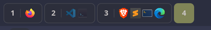
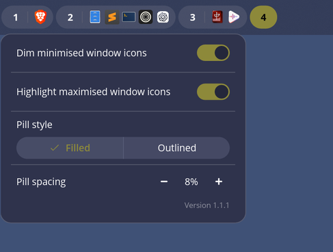
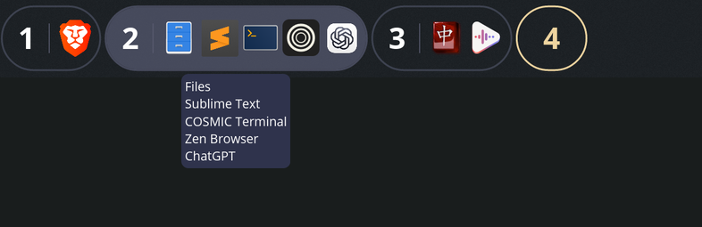

# Workspace Icons

Workspace Icons is a third-party [COSMIC](https://en.wikipedia.org/wiki/COSMIC_desktop) panel applet based on the COSMIC
Numbered Workspaces applet. It shows application icons beside each workspace
number so you can see where windows are at a glance.

## Screenshots



<br />



<br />



## Features

- Displays application icons beside each workspace number.
- Can hide workspace numbers and names with **Show workspace numbers**.
- Can show separate icons for each open window by disabling application grouping.
- Associates windows with the correct workspace and monitor.
- Configures up to sixteen visible icons per workspace before showing an overflow count.
- Dims minimised window icons.
- Highlights maximised window icons.
- Preserves workspace switching, scrolling, and workspace overview behavior.

## Workspace Numbers

**Show workspace numbers** is enabled by default and preserves workspace names
assigned in COSMIC. Disable it to show only application icons and their overflow
count, removing the number section and its divider to save panel space.
Pills follow COSMIC's **Round**, **Slightly round**, or **Square** style with
numbers either shown or hidden. With **Round** style, numbers hidden, and
**Pill spacing** at 0, a single application icon sits in a circular pill,
including when maximized highlighting is enabled. Additional icons extend the
pill while retaining balanced end padding.

Empty workspaces show a small solid dot when pinned, or when unpinned and not
last. The last unpinned workspace shows a `+`. The last workspace is determined
per monitor, before panel-space clipping (bottommost on vertical panels). An
empty active workspace can remain before later workspaces until you switch away.
Hover over an empty workspace to see its name and pinned/empty status.
The dot and `+` match the pill's outline color when outlined, including the
configured inactive brightness and opacity. Inactive filled pills cut these
symbols out of the fill so the panel shows through, including when an outlined pill fills on
hover. Focused filled pills keep their existing symbol color. The `+N`
application overflow count continues to use the same colors as workspace numbers.

These symbols retain normal workspace behavior: clicking an inactive workspace
switches to it, and clicking the active workspace opens the overview. The `+`
selects the existing empty workspace; it does not create another workspace.

## Pill Colors

Pill colors use semantic COSMIC theme tokens, so their rendered values follow
the user's current theme. In the table below, `brighten(C, P)` adjusts only the
Oklab lightness of color `C` by the configured inactive pill brightness `P`
(−75% to +75%), preserving its alpha. `W` is the configured outline thickness.

| State | Mode | Interaction | Fill | Border | Workspace number / +N | Symbolic application icons | Separator |
|---|---|---|---|---|---|---|---|
| Inactive | Filled | Resting | `brighten(button.base, P)` | None | `button.on` | `button.on` | `current_container().divider` |
| Inactive | Filled | Hovered | `brighten(button.hover, P)` | None | `button.on` | `button.on` | `current_container().divider` |
| Inactive | Outlined | Resting | None | `brighten(button.base, P)`, width `W` | `button.on` | `button.on` | `current_container().divider` |
| Inactive | Outlined | Hovered | `brighten(button.hover, P)` | None | `button.on` | `button.on` | `current_container().divider` |
| Active | Filled | Resting | `accent_button.base` | None | `accent_button.on` | `accent_button.on` | `current_container().divider` |
| Active | Filled | Hovered | `accent_button.hover` | None | `accent_button.on` | `accent_button.on` | `current_container().divider` |
| Active | Outlined | Resting | None | `accent_button.base`, width `W` | `accent_text`, falling back to `accent_button.base` | `current_container().component.on` | `accent_text`, falling back to `accent_button.base` |
| Active | Outlined | Hovered | `accent_button.hover` | None | `accent_button.on` | `accent_button.on` | `accent_button.on` |
| Urgent | Filled | Resting | `button.base` | `destructive_button.base`, 1 px | `destructive_button.base` | `destructive_button.base` | `destructive_button.base` |
| Urgent | Filled | Hovered | `button.hover` | `destructive_button.base`, 1 px | `destructive_button.base` | `destructive_button.base` | `destructive_button.base` |
| Urgent | Outlined | Resting | None | `destructive_button.base`, width `W` | `destructive_button.base` | `destructive_button.base` | `destructive_button.base` |
| Urgent | Outlined | Hovered | `button.hover` | `destructive_button.base`, width `W` | `destructive_button.base` | `destructive_button.base` | `destructive_button.base` |

The **Active filled** option combines a filled active pill with outlined inactive
pills. Hovered outlined active and inactive pills remove their border after
filling to avoid a visible seam. Urgent pills keep their destructive border on
hover. If a workspace is both active and urgent, active styling takes
precedence.

At 0%, ordinary inactive pills use COSMIC's `button.base` and `button.hover`
colors exactly. Negative brightness moves their lightness partway toward black;
positive brightness moves it partway toward white. The button tokens' alpha is
unchanged, so transparent and frosted-glass panels remain visible through the
pills. The previous inactive pill contrast setting does not migrate; brightness
starts at 0% while other preferences remain available.

## Install From Source

Requires COSMIC Desktop development dependencies and a Rust toolchain.

```bash
git clone https://github.com/crocodile/cosmic-ext-applet-workspace-icons.git
cd cosmic-ext-applet-workspace-icons
just install
```

Then open COSMIC panel settings and add **Workspace Icons**.

## Testing The Flatpak Build

Workspace Icons is intended to be distributed as a Flatpak through the COSMIC
Store. Until then, the Flatpak packaging draft lives in
`packaging/io.github.crocodile.cosmic-ext-applet-workspace-icons/`.

Before testing the Flatpak, remove any source install first so COSMIC does not
show stale or duplicate applet entries:

```bash
just uninstall
```

Then install the local Flatpak build:

```bash
flatpak-builder --user --install --force-clean \
  build-dir/workspace-icons-flatpak \
  packaging/io.github.crocodile.cosmic-ext-applet-workspace-icons/io.github.crocodile.cosmic-ext-applet-workspace-icons.json
```

If the applet list does not refresh immediately, log out and back in. After
adding **Workspace Icons** to the panel, confirm that the Flatpak version is
running with:

```bash
flatpak ps
```

To remove the local Flatpak test install:

```bash
flatpak uninstall --user io.github.crocodile.cosmic-ext-applet-workspace-icons
```

## Development

```bash
just build
just install
just uninstall
cargo fmt --all -- --check
cargo check
cargo test
```

For a technical map of how this differs from COSMIC's Numbered Workspaces applet,
see [Changes From COSMIC Numbered Workspaces](docs/numbered-workspaces-changes.md).

## License

GPL-3.0-only.
