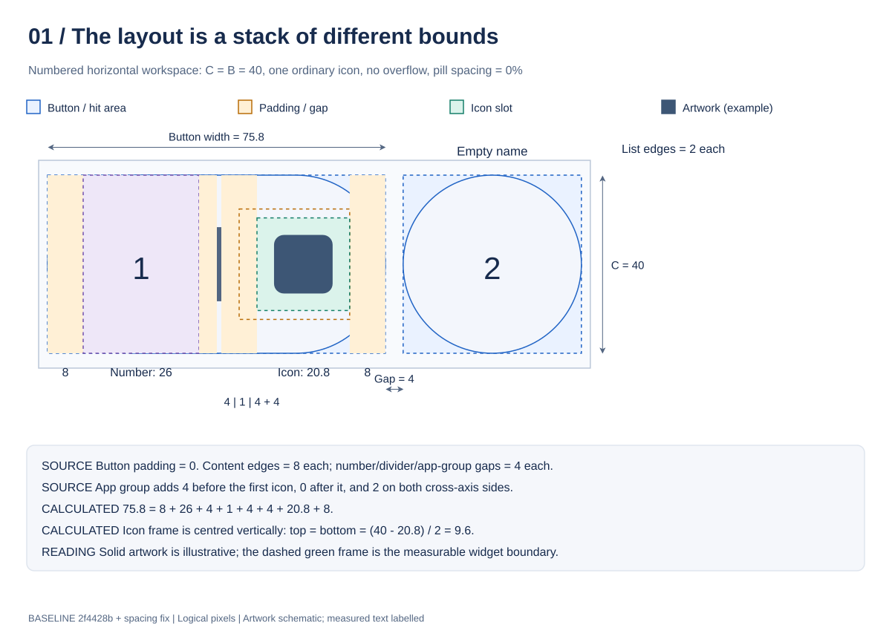
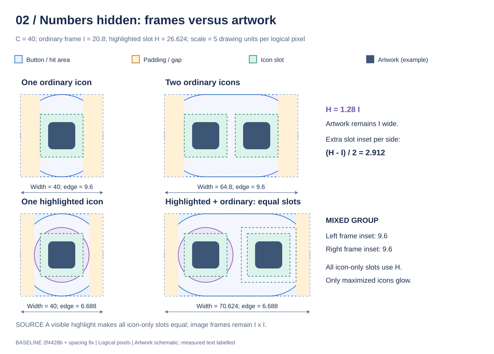
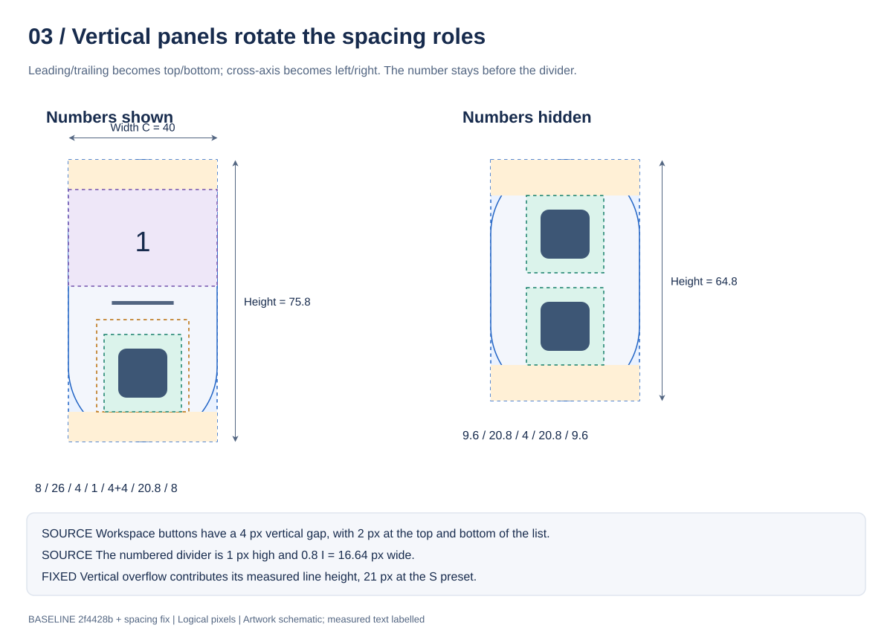
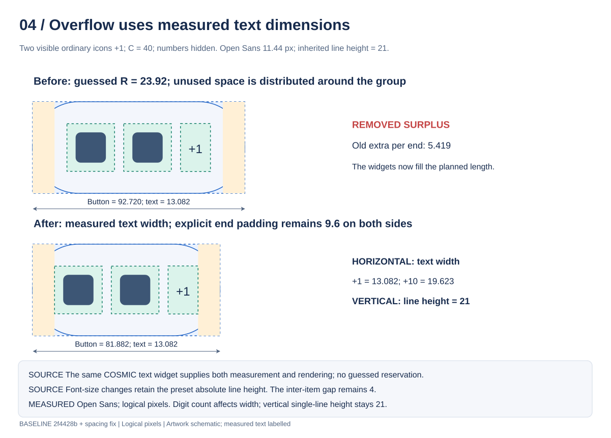
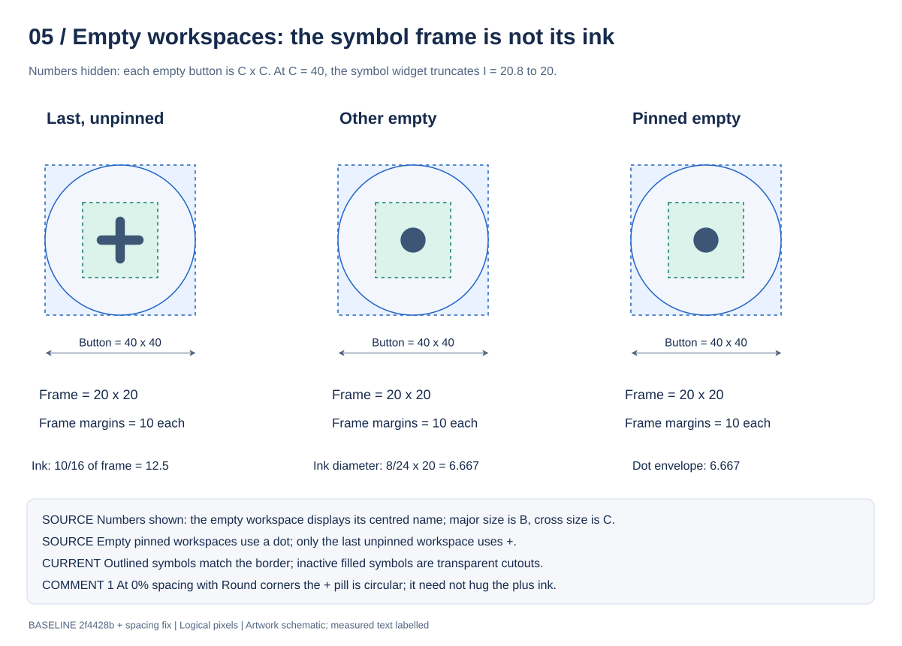
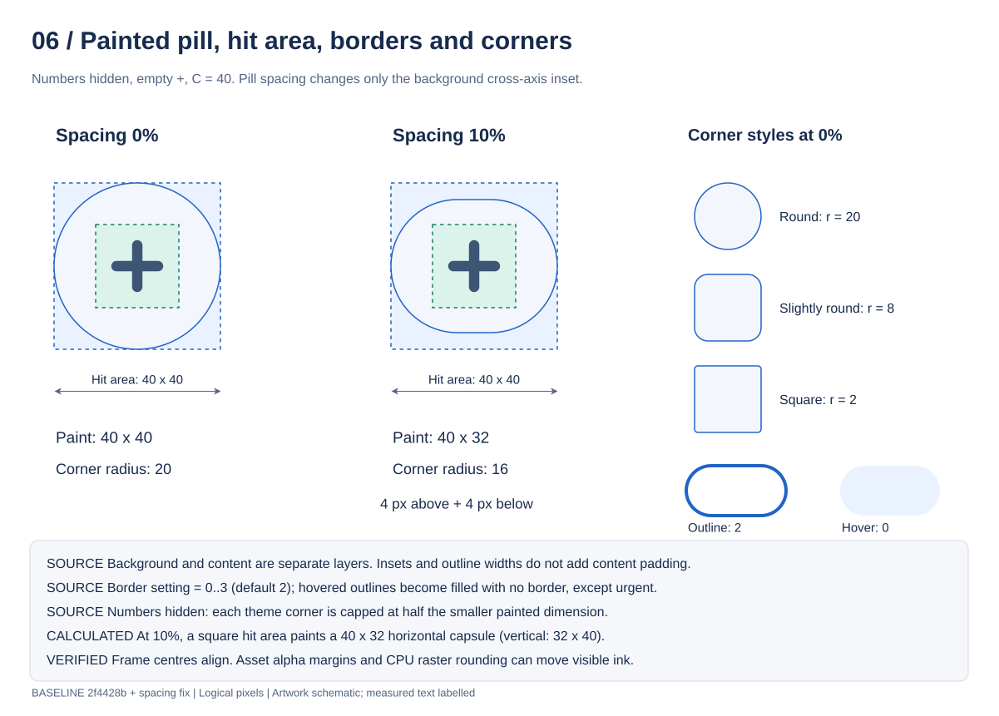
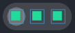
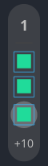

# Workspace layout and spacing

This guide separates the clickable button, painted pill, content group, icon slot, image frame and visible artwork. Dimensions are logical pixels unless a physical-pixel measurement is explicitly identified.

## Baseline and scope of this update

The original audit used [`2f4428bc34f0ffac9aa2c1d032128b9f586a023a`](https://github.com/crocodile/cosmic-ext-applet-workspace-icons/commit/2f4428bc34f0ffac9aa2c1d032128b9f586a023a), `codex/pr56-inverse-pin-dot`. This update was prepared on `codex/pr56-dot-plus-colours`, on top of `5cd99a0`. It retains the earlier dot, symbol-colour, opacity and cut-out edge fixes. The existing editable diagrams were updated to describe the spacing changes.

Comparison with the audit baseline established that:

- Empty pinned workspaces now use a plain dot, and empty-workspace symbols have separate colour/cut-out handling. These changes predate this task.
- `app_group_major_size()` still reserved `1.15 × icon_size` for `+N`, while the text rendered at its natural size. Neither overflow sizing nor the mixed-slot layout had been corrected.
- libcosmic is still locked to `d9b2b38bf4dc8f2af3d7dc7be9fa296ab75c3170`, and cosmic-panel to `82b76c9b01d2697bc10d62b6c511c26cc6cc8e8f`. The branch added a `resvg` development dependency before this task; this task adds no dependencies or configuration fields.

Current sources: [implementation](../src/components/app.rs), [layout and visual verification](../src/components/workspace_layout_tests.rs), [configuration](../src/config.rs). Historical links below identify the reported problems, rather than promising a reproduction of the reporters' exact builds.

## Findings and resulting behaviour

| Report | Confirmed cause | Result |
| --- | --- | --- |
| [Overflow adds apparent padding](https://github.com/crocodile/cosmic-ext-applet-workspace-icons/pull/56#issuecomment-6153583422) | Calculated button length differed from the laid-out content. At XS, three ordinary icons plus `+1` calculated 96.416 but needed 88.716 with the verification font. Centring distributed the surplus. | Measure the same COSMIC text widget used for display. Horizontal panels use its width; vertical panels use its line height. Adding overflow grows the button by exactly the text extent plus the intended 4-pixel gap. Explicit end padding stays unchanged. |
| [Uneven icon alignment](https://github.com/crocodile/cosmic-ext-applet-workspace-icons/pull/56#issuecomment-6205864077) | Icon-only groups with mixed slot sizes had unequal image-frame end margins. At S, highlighted-first/ordinary-last produced 9.6 versus 6.688. | If an icon-only group contains a visible highlighted icon, all its visible icons get the same enlarged slot. Only maximized icons receive the glow. Image frames stay the same size. End margins now match in either order. |
| Reported vertical offset | No general cross-axis **widget-layout** offset was reproduced. Controlled and real image frames have the same cross-axis centre as the button and painted pill. | No speculative top/bottom padding adjustment. Asset alpha margins and small software-rasterization offsets are recorded separately below. |

The reporters' original font, panel settings, scaling and live compositor state are unknown. The verification establishes the causes above under recorded conditions; it does not attribute every pixel in those screenshots to a single cause.

## 1. Read the nested bounds first



```text
Applet surface and panel constraints
└─ Workspace list: leading/trailing padding 2, button gap 4
   └─ Transparent clickable button: explicit dimensions, padding 0
      └─ Stack with the same bounds as the button
         ├─ Painted pill: cross-axis inset, fill/border, theme corner radius
         └─ Centred content: explicit edge padding
            ├─ Number + gap + divider + gap, when numbers are shown
            └─ App group: optional leading/cross padding
               ├─ Image frames inside ordinary or uniform enlarged slots
               └─ +N with dimensions measured from the same text widget
```

| Boundary or gap | Numbers shown | Numbers hidden |
| --- | --- | --- |
| List leading/trailing padding | 2 each | 2 each |
| Gap between buttons | 4 | 4 |
| Button widget padding | 0 | 0 |
| Occupied content end padding | 8 each | `max((C − largest visible slot) / 2, 0)` each |
| Number → divider → app-group gaps | 4 on each side of a 1-pixel divider | Absent |
| App-group leading/trailing padding | 4 / 0 | 0 / 0 |
| App-group cross-axis padding | 2 each | 0 |
| Gap between adjacent slots or before `+N` | 4 | 4 |
| Empty content padding | 0 | 0 |

The divider-to-first-slot gap in numbered mode remains 8: the 4-pixel row/column gap plus 4-pixel app-group leading padding. Minimization changes opacity, not geometry. The number section, divider, name handling, click/scroll actions and tooltips are unchanged.

## 2. Sizing calculations now agree with widget layout

The **major axis** follows the panel: width horizontally, height vertically. The **cross axis** is the panel thickness.

| Symbol | Definition |
| --- | --- |
| `C` | Suggested window cross-axis size, including configured bounds |
| `B` | Suggested symbolic icon size plus twice the suggested cross-axis padding |
| `I` | Image-frame side: `max(0.52 C, 16)` |
| `H` | Enlarged slot side: `1.28 I`; the image frame remains `I × I` |
| `N` | Occupied number-section major size: `min(max(0.65 B, 20), max(I, 28))` |
| `v`, `o` | Visible-icon and overflow counts, after grouping and the configured limit |
| `S_j` | Visible slot side; see the uniform-slot rule below |
| `L` | App-group leading padding: 4 with numbers, otherwise 0 |
| `E` | End padding: 8 with numbers; otherwise `max((C − max(S_j)) / 2, 0)` |
| `T` | Intrinsic size of the overflow text widget, with the actual interface font and preset line height |
| `R` | `T.width` horizontally, `T.height` vertically; zero without overflow |
| `P` | Painted background cross-axis inset on each side: `C × pill_spacing_percent / 100` |

For occupied workspaces:

```text
A = sum(S_j) + 4 max(v − 1, 0) + L + (R + 4 if o > 0, else 0)
M with numbers    = 2 E + N + 4 + 1 + 4 + A
M without numbers = 2 E + A
```

Empty workspaces retain `M = B` with numbers, `M = C` without. List length is `sum(M) + 4 max(workspace_count − 1, 0) + 4` for the two list edges. `popup_index()` and button rendering consume the same corrected size calculation, so overflow no longer distorts the panel-space estimate. Exposing workspaces beyond the visible prefix remains an existing TODO.

`workspace_overflow_text()` is the shared text factory. `workspace_overflow_size()` lays that actual widget out with the app's CPU renderer, using a thread-local renderer to reuse font resources. Display uses the same factory and the measured dimensions. This avoids guessed multipliers, character-width tables and duplicated typography presets. The font and size are explicit on the widget; the measurement renderer's defaults do not determine them. No GPU or additional dependency is created for measurement.

### Absolute text line heights

The text factory preserves `core.applet.text()` typography, then changes only the overflow font size to `max(0.55 I, 10)`. It also disables wrapping: `+N` is one label. Changing `.size()` **does not replace COSMIC's inherited absolute line height**. The measurement therefore includes that line height automatically.

| Panel preset | Usual `B = C` | `I` | Overflow font size | Inherited absolute line height |
| --- | ---: | ---: | ---: | ---: |
| XS | 32 | 16.64 | 10 | 21 |
| S | 40 | 20.8 | 11.44 | 21 |
| M | 56 | 29.12 | 16.016 | 30 |
| L | 64 | 33.28 | 18.304 | 36 |
| XL | 80 | 41.6 | 22.88 | 43 |

Configured cross-axis bounds can differ from the panel preset; the measurement uses the actual applet text factory rather than inferring typography from `C`. Hardcoded applet sizes use their normal text defaults. Workspace names stay bold and retain the existing XL size override of 33 when `I >= 40`.

### Worked sizes: `C = B = 40`

Here `I = 20.8`, `H = 26.624`, `N = 26`. Values involving text below are calculated using the **measured Open Sans Regular** widths in the verification record; they are examples, not constants in the app.

| Content | Numbers | `E` | Button major size |
| --- | --- | ---: | ---: |
| Empty name | Shown | 0 | 40 |
| Empty plus or dot | Hidden | 0 explicit | 40 |
| One ordinary icon | Shown | 8 | 75.8 |
| Two ordinary icons | Shown | 8 | 100.6 |
| One ordinary icon | Hidden | 9.6 | 40 |
| Two ordinary icons | Hidden | 9.6 | 64.8 |
| One highlighted icon | Hidden | 6.688 | 40 |
| Highlighted + ordinary, equal enlarged slots | Hidden | 6.688 | 70.624 |
| Two ordinary icons + `+1`, horizontal | Hidden | 9.6 | 81.882 |
| Two ordinary icons + `+1`, vertical | Hidden | 9.6 | 89.8 |
| Two ordinary icons + `+1`, horizontal | Shown | 8 | 117.682 |
| Two ordinary icons + `+1`, vertical | Shown | 8 | 125.6 |

## 3. Equal image-frame margins in icon-only groups



With numbers hidden, if highlighting is enabled and **any visible icon** is maximized, every visible icon gets an `H × H` slot. Only maximized slots have the circular glow; ordinary slots are transparent. The image is always `I × I`, centred inside its slot.

For a mixed group without overflow, each end's image-frame margin is:

```text
E + (H − I) / 2 = (C − I) / 2
```

At S this is `6.688 + 2.912 = 9.6` on both ends, including when the highlighted icon is first or last. This also avoids shifting the frame margins when an ordinary icon is replaced by a highlighted one. An unhighlighted slot between two highlights has room for the same frame inset. Extra slot space deliberately grows the group so glows are retained without clipping; it is not removed by squeezing frames together.

Without visible highlights, slots remain `I × I`. Hidden overflow windows cannot enlarge visible slots. Numbered mode keeps its existing per-icon slot sizing and number/divider spacing; symmetry around the icon strip is not the symmetry of the complete numbered button.

The 4-pixel gap is between **slots**. Image-frame gaps in a uniformly enlarged group include both internal frame insets as well. Once overflow is present, the label is the last group item; its end padding is `E`, while the first icon frame also has its own within-slot inset. The layout does not invent additional end padding for `+N`.

## 4. Vertical panels



The number, divider and app strip form a column. Leading/trailing padding becomes top/bottom padding; cross-axis padding becomes left/right. The divider is 1 high and `0.8 I` wide. Each image frame's horizontal centre remains the button centre.

Overflow contributes its **line height**, not its text width, to button height. At S, `+1`, `+10`, `+100` and `+1000` each add **21 + 4 = 25** to the button's height. Their different glyph widths do not create spare vertical length. With numbers shown, app-group cross padding remains 2 on both sides.

## 5. Overflow: measured before and after



Measured with Open Sans Regular, S preset, font size 11.44, inherited line height 21:

| Label | Measured width | Vertical contribution | Horizontal button growth, including gap |
| --- | ---: | ---: | ---: |
| `+1` | 13.082 | 21 | 17.082 |
| `+10` | 19.623 | 21 | 23.623 |
| `+100` | 26.165 | 21 | 30.165 |
| `+1000` | 32.706 | 21 | 36.706 |

The baseline reserved 23.92 for every one of these. For two visible ordinary icons and `+1`, it calculated 92.72 horizontally; the correct measured length is 81.882. The old centring surplus was 10.838, or **5.419 per end**, with this font. Vertically the corresponding surplus was `23.92 − 21 = 2.92` in total.

These are measurements of widget line boxes and advances, not claims about each opaque glyph edge. A font can have side bearings inside its measured line box. The explicit padding, intended gap and calculated button size now match the widget layout regardless of those bearings.

## 6. Empty symbols, painted bounds and interactions



The spacing change leaves empty workspaces alone. With numbers shown they display their names. Without numbers, occupied workspaces show app icons; empty pinned workspaces and other non-last empty workspaces use the dot; the last unpinned empty workspace uses `+`. Selection uses the complete monitor-local list before panel clipping.

At `C = 40`, empty symbol frames truncate `I = 20.8` to **20 × 20**, centred in the unchanged **40 × 40** button. The plus ink envelope is **12.5 × 12.5**; the dot diameter is **6.667**. These describe the symbol geometry whether the state paints a foreground or cuts a hole in the fill. Focused filled symbols keep their current colour. Clicking `+` selects the existing empty workspace; it does not create a workspace.



Pill spacing changes only the background's cross-axis inset. At `C = 40`, 10% paints **40 × 32** horizontally or **32 × 40** vertically, inside the same **40 × 40** clickable bounds. It does not move content, shorten the button's major dimension or change the gap between buttons.

Theme corners, the hidden-number radius cap, outline widths 0–3, urgent borders, fill/outline selection and hover styles retain their existing rules. Numbered names, grouping, minimization, highlights, persistence and input handlers are unchanged. The earlier cut-out rendering fix retains urgent borders and handles fractional painted bounds separately from content layout.

## 7. Verification record — 18 October 2026

### Laid-out widget bounds

The regression tests build the **production** pill tree inside a real transparent button and run Iced's layout engine. They inspect the button, painted background, content, strip, individual slots and leaf image frames separately. They compare calculated button length with the actual laid-out content; merely testing the size arithmetic would have missed the original bug.

- 5,120 layout cases: both orientations; numbers shown/hidden; XS/S/M/XL cross sizes 32/40/56/80; no overflow, `+1`, `+10`, `+100`; ordinary, all highlighted and mixed patterns with the highlight first, last or in the middle; spacing 0/10%; filled/outlined; resting/hovered.
- Separate natural-text checks include XS/S/M/L/XL, `+1000`, and the inherited absolute line heights 21/30/36/43. Adding the label grows the button only by its measured major-axis contribution plus 4. End padding and the leading content position remain stable.
- Visible-limit checks cover 1, 2 and 16 icons, including a maximized window hidden in overflow and disabled highlighting. Neither case enlarges visible slots.
- The earlier single-icon, empty-symbol, theme-corner, orientation, state-colour and configuration tests remain in the suite.

### Renderer and artwork checks

[Recorded measurements and settings](layout-verification/measurements.json) accompany 48 raw render samples and their image-frame overlays. These use Iced's **tiny-skia CPU renderer**, **Open Sans Regular** (`/usr/share/fonts/open-sans/OpenSans-Regular.ttf`), the dark theme, S preset (`C = 40`), display scales **100% and 125%**, three visible icons, highlighting enabled, and the per-image settings in the JSON. The samples cover both orientations, hidden/shown numbers, filled/resting outlined/hovered outlined states, and spacing 0/10%.





A controlled symmetric square isolates layout from artwork. A deliberately asymmetric control verifies that the app does not compensate for internal transparent margins. Real comparisons use the locally installed **COSMIC terminal** and **Brave** SVGs; asset paths and alpha envelopes are recorded. No third-party artwork was copied into source fixtures or modified.

At a normalized 240 × 240 asset raster, the terminal's alpha envelope was `[15, 52, 225, 218]`: its visible-artwork vertical midpoint is 135 rather than the frame midpoint 120. The deliberately asymmetric control has the expected offset; the Brave envelope spans the complete source frame. These assets receive the same centred frame layout.

**Vertical conclusion:** no general vertical widget-layout defect was reproduced. With symmetric artwork at 100%, the CPU SVG renderer painted ink about **1 physical pixel up** relative to the fractional frame centre; at 125% the tested cross-axis ink centres aligned. Along the major axis, raster rounding varied with fractional slot positions, reaching about 1.25 physical pixels. This is separate from the corrected mixed-slot margins and from asset alpha margins. No global left/top padding compensation was added.

The subsequently supplied zoomed screenshot appears to show icons above the pill centre; its vertical offset remains unresolved. The frame-layout tests do not establish that artwork margins caused that screenshot. The reviewers' exact live panel, compositor clipping, other fonts/assets, and GPU rendering remain unverified. The screenshots here are offscreen renders of the actual production widgets, not captures of the running panel.

### Checks and reproduction

The full suite passes with **62 tests**, plus the separately invoked visual-evidence test. The visual test is ignored in the default suite because it writes files and inspects optional local assets. Run:

```bash
cargo test --locked --offline
cargo check --locked --offline
cargo build --release --locked --offline
git diff --check
WORKSPACE_LAYOUT_OUTPUT="$PWD/docs/layout-verification" \
  cargo test --locked --offline --lib render_layout_samples_and_asset_bounds -- --ignored --nocapture
```

Formatting was checked with the installed rustfmt from the Flatpak Rust SDK extension, because the system `cargo fmt` subcommand is absent. No dependency lock changes are needed for this fix. Separate pre-existing uncommitted source work was retained locally when preparing the PR commits, and unrelated `dist/` files were left untouched.

## Edit and maintain the diagrams

[workspace-layout.drawio](diagrams/workspace-layout.drawio) contains the six editable native-shape pages. The existing pages were retained; the mixed-slot geometry and overflow page were updated, and historical empty-symbol labels were brought into line with the current branch. SVG text is schematic; measured font widths are explicitly labelled.

Edit the native source first, then export matching SVGs. The installed draw.io CLI uses **one-based** page indices:

```bash
drawio --export --format svg --svg-theme light --page-index 1 \
  --output docs/diagrams/01-anatomy.svg docs/diagrams/workspace-layout.drawio
```

Repeat for pages 2–6. Preserve `html=0` labels, native SVG text and the white page background. Recheck actual bounds and typography when changing constants, dependency revisions or rendering widgets. Arithmetic examples and schematic artwork alone cannot establish visible centring.
